# Architecture, in diagrams

How the dashboard receives, stores, derives and shows journeys. The diagrams
are Mermaid (GitHub draws them); the text stays readable without rendering.

For the app side (what the library records and sends), see
[architecture.md](https://github.com/luizroddev/otel_flutter_bridge/blob/main/docs/architecture.md)
in `otel_flutter_bridge`. For adopting both in an existing system, see the
[adoption guide](https://github.com/luizroddev/otel_flutter_bridge/blob/main/docs/adoption-guide.pt-BR.md)
(Portuguese).

1. [Components and modes](#1-components-and-modes)
2. [Where it runs](#2-where-it-runs)
3. [Receiving a request](#3-receiving-a-request)
4. [The aggregator](#4-the-aggregator)
5. [Collections](#5-collections)
6. [From a page to the data](#6-from-a-page-to-the-data)
7. [How a journey is built](#7-how-a-journey-is-built)
8. [How long until it shows, how long it stays](#8-how-long-until-it-shows-how-long-it-stays)

## 1. Components and modes

One Node process with three parts, switched on by `MODE`. Writers only
insert `spans` and `events`. The aggregator derives everything else
([storage-schema.md](storage-schema.md)).

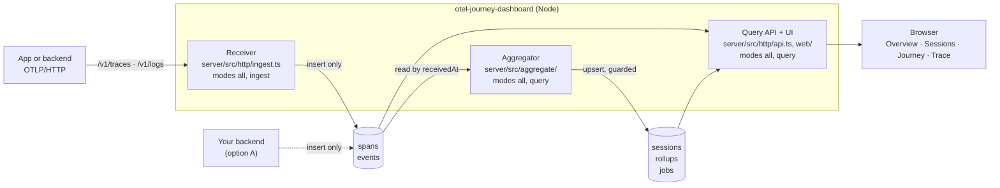

| `MODE` | Receiver | Aggregator | API and UI |
|---|---|---|---|
| `all` | yes | yes | yes |
| `ingest` | yes | no | no |
| `query` | no | yes (`AGGREGATOR=off` to skip) | yes |

## 2. Where it runs

**Local or personal projects**: one process does everything.

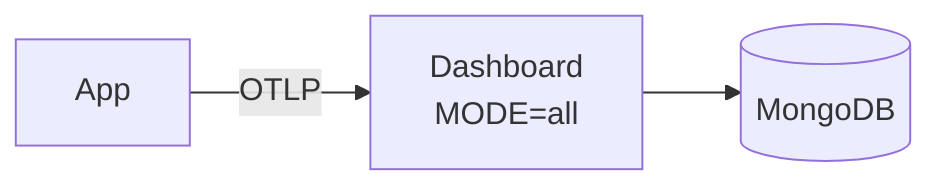

**Option A: your backend writes MongoDB.** It already authenticates the
device and the user, so it stamps them, applies its allowlist and only
inserts. The dashboard aggregates and serves, behind your SSO.

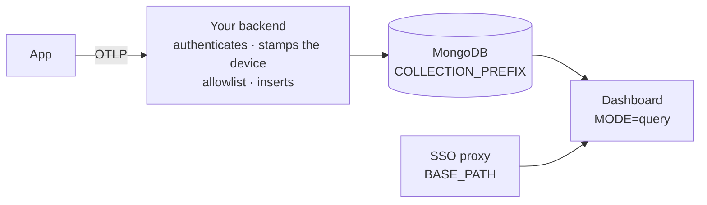

**Option B: your backend forwards.** When it cannot write MongoDB yet, it
authenticates and forwards the body untouched, with trusted headers, to a
receiver only it can reach.

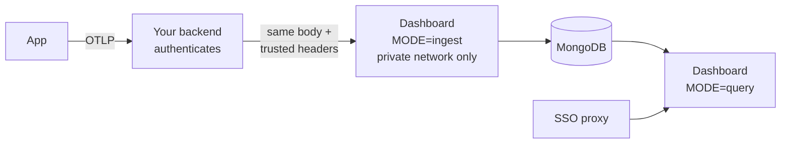

Details: [backend-integration.md](backend-integration.md).

## 3. Receiving a request

The same rules apply to any writer; the conformance check
(`npm run conformance`) verifies them on what was stored.

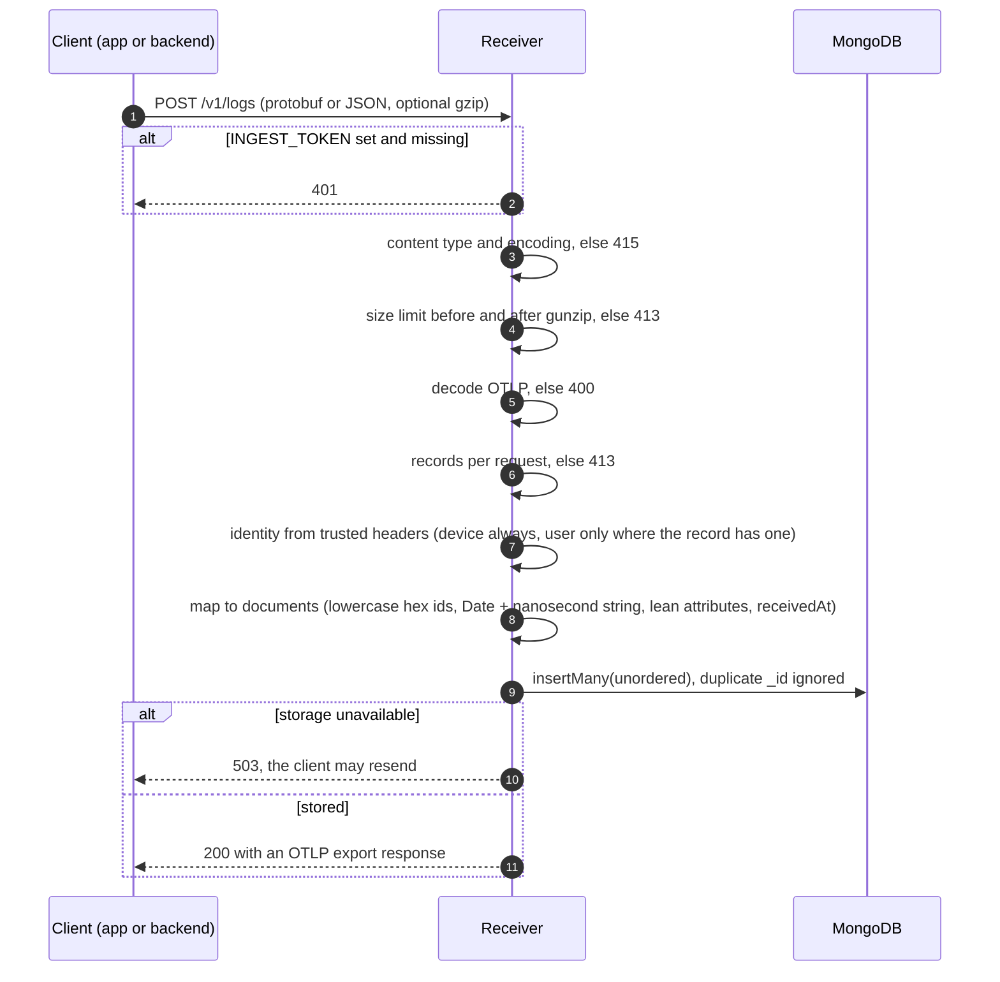

## 4. The aggregator

Every 15 seconds, one instance (the lease holder) reads what arrived since
its last run, in chunks of `receivedAt`, and updates the session summaries
and the hourly counters those records touch. A chunk redone after a crash
changes nothing that was already applied.

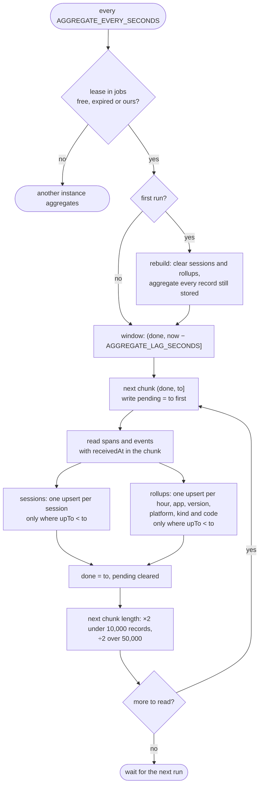

What each document holds:

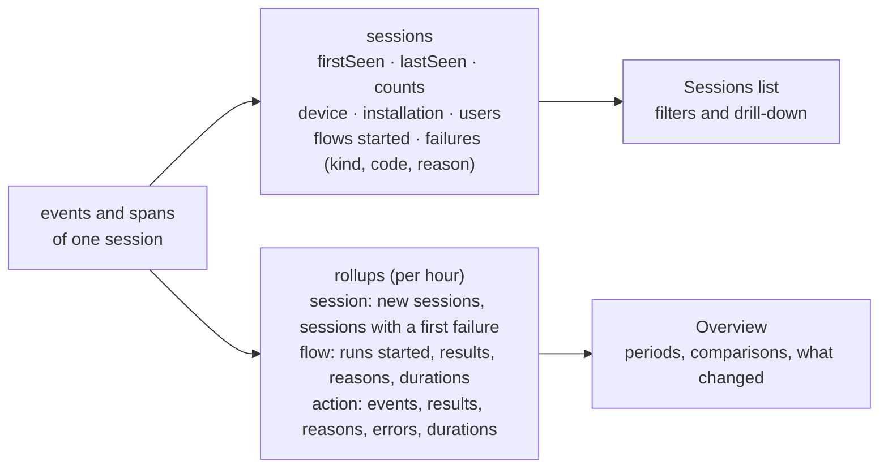

A flow run is counted in the hour it **started** (end time minus its
duration), so runs started minus results is what has no conclusion.

## 5. Collections

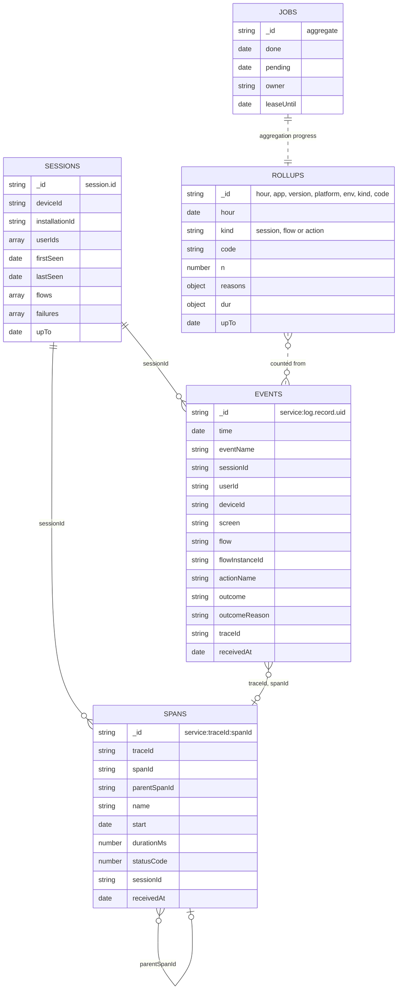

| Collection | Written by | Read by | TTL |
|---|---|---|---|
| `spans`, `events` | receiver or your backend (insert only) | aggregator, API | `RETENTION_DAYS` |
| `sessions` | aggregator | API (lists, filters) | latest record's `expireAt` |
| `rollups` | aggregator | API (overview) | `ROLLUP_RETENTION_DAYS` |
| `jobs` | aggregator | aggregator | none |

With `COLLECTION_PREFIX=journey_`, every name carries the prefix.

## 6. From a page to the data

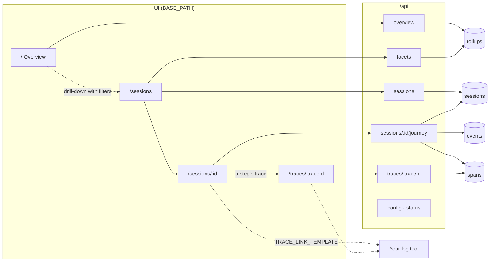

Endpoints: [query-api.md](query-api.md).

## 7. How a journey is built

`GET /api/sessions/:id/journey` turns the session's events into steps and
flow runs (`server/src/query/journey.ts`).

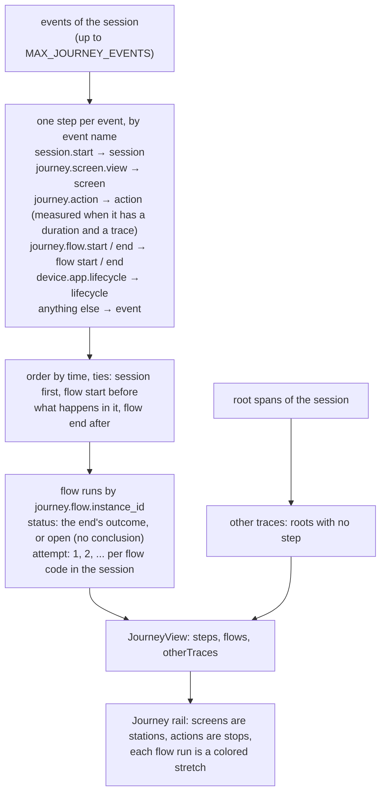

## 8. How long until it shows, how long it stays

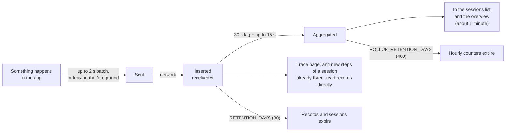

The overview reads the hourly counters, so trends outlive the records
themselves.
